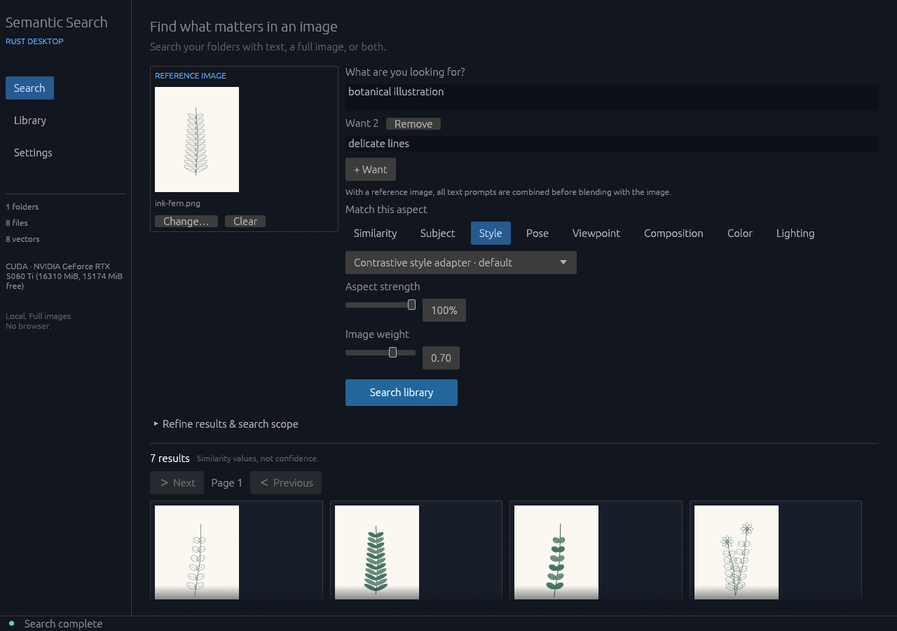
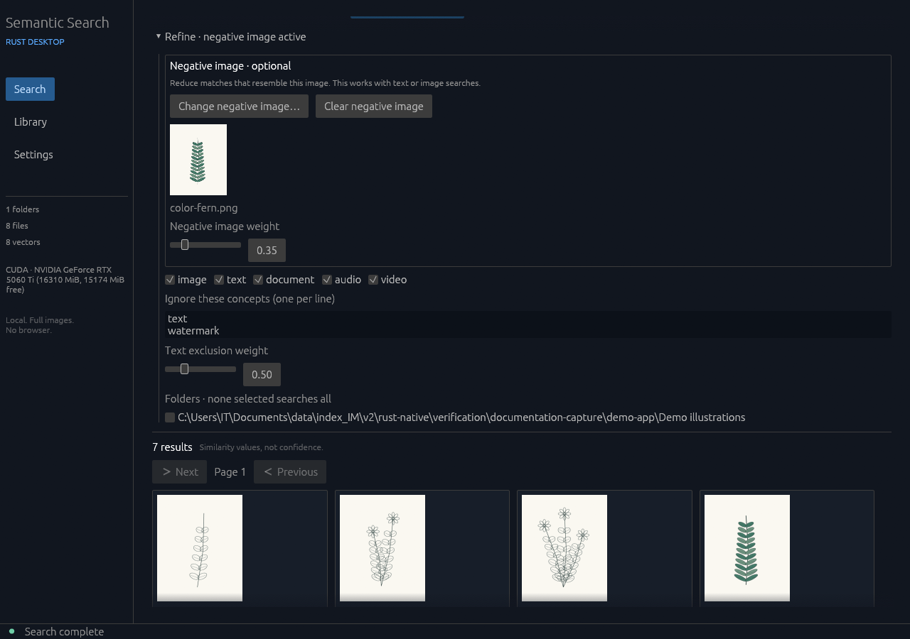
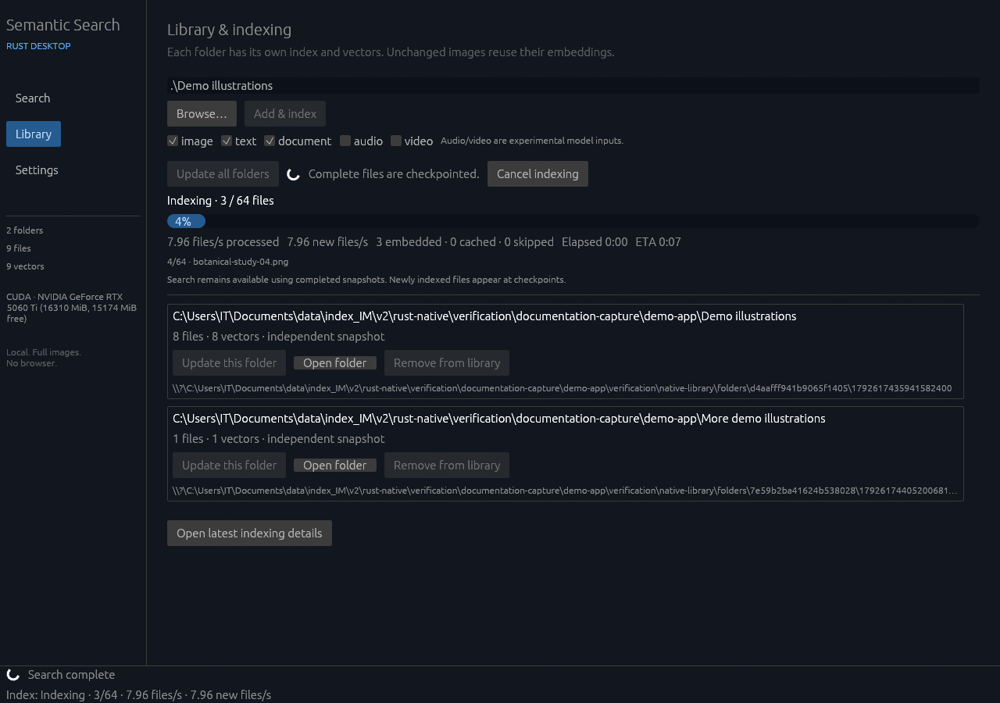
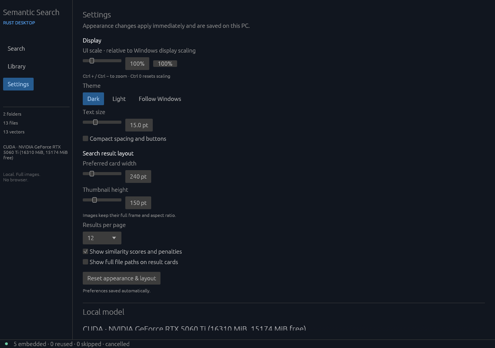
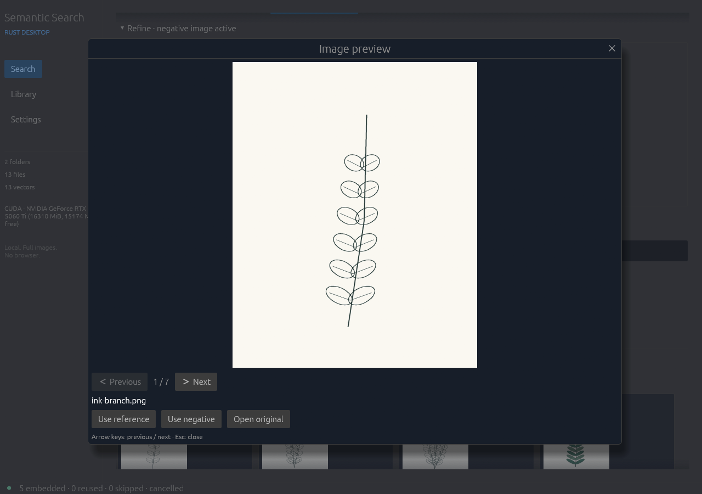

# Refseek

**Find pictures in your own art and reference folders using words, an example image, or both.**

Refseek offers two Windows apps. Both include the model and processing tools, run searches locally, and support similarity, subject, style, pose, viewpoint, composition, colour and lighting searches.

## Download: choose your interface

Open **[the latest release](https://github.com/Y1-studio/Refseek/releases/latest)** and expand **Assets**. Download one of these application files:

| Download | Choose it when… |
| --- | --- |
| **[Refseek-Desktop.exe](https://github.com/Y1-studio/Refseek/releases/latest/download/Refseek-Desktop.exe)** — recommended | You want a desktop app with its own window, display settings and indexing progress. Built with Rust; no browser needed. |
| **[Refseek-Browser.exe](https://github.com/Y1-studio/Refseek/releases/latest/download/Refseek-Browser.exe)** | You prefer the Python edition's browser interface. It opens a local page in your default browser; keep its launcher window open. |

An **.exe** is a Windows application. Neither download needs a separate Python or Rust installation, model download, or separately started model server. The automatic **Source code** downloads are for developers.

Put the app in its own writable folder, double-click it, wait for model loading, then add a folder of pictures in Library and start indexing. Indexing creates the searchable catalogue; it leaves the original pictures where they are. Allow several gigabytes of free disk space for included resources. Graphics drivers must already be installed. The apps try compatible NVIDIA CUDA devices, then Vulkan graphics, then CPU.

If you download both editions, give each its own folder. Their catalogues and settings are separate. They can search the same original picture folders.

## See the desktop app

[](docs/screenshots/search.png)

*Actual Rust app screenshot using original demo illustrations. Click for full size. The browser edition has a different layout.*

| Refine and negative images | Library and indexing |
| --- | --- |
| [](docs/screenshots/refine.png) | [](docs/screenshots/library.png) |

| Display settings | Image viewer |
| --- | --- |
| [](docs/screenshots/settings.png) | [](docs/screenshots/viewer.png) |

## Search controls

- Search with text, a whole image, or a blend of both. Choose the aspect you want to match.
- Style starts with the frozen **Contrastive style adapter**; the Current style adapter is also available.
- Add multiple Want descriptions and refine with exclusions or a negative example image.
- Keep folder indexes separate, reuse unchanged files and search saved results while indexing continues.
- Browse results with arrow keys in a stable image preview.

Style and pose matches remain approximate. Pose uses embedding projections, without a joint detector. The style adapters were fitted on 12,940 images across 84 artists. Earlier evaluation scores do not establish retrieval accuracy for the full-data exports or their Q8 transfer on new collections.

## Guides and source

| Edition | User guide | Source and build instructions |
| --- | --- | --- |
| Rust desktop | [Artist's guide with screenshots](docs/USER_GUIDE.md) | [native/](native/README.md) · [Build guide](docs/NATIVE_BUILDING.md) |
| Python/browser | [Browser guide](docs/PYTHON_GUIDE.md) | [python/](python/README.md) |

Source layout:

```text
Refseek/
├── README.md
├── native/
├── python/
├── docs/
└── THIRD_PARTY_NOTICES.md
```

Large binaries, model weights, frozen adapters, research images, dependency caches and personal libraries are excluded from Git. Builders recover exact application resources from a matching release; each edition documents how. This snapshot provides Windows x64 downloads; no Linux AppImage is included.

See [third-party notices](THIRD_PARTY_NOTICES.md) and the [publishing guide](docs/PUBLISHING.md). No project-wide source license has been selected. Third-party components keep their own terms.
