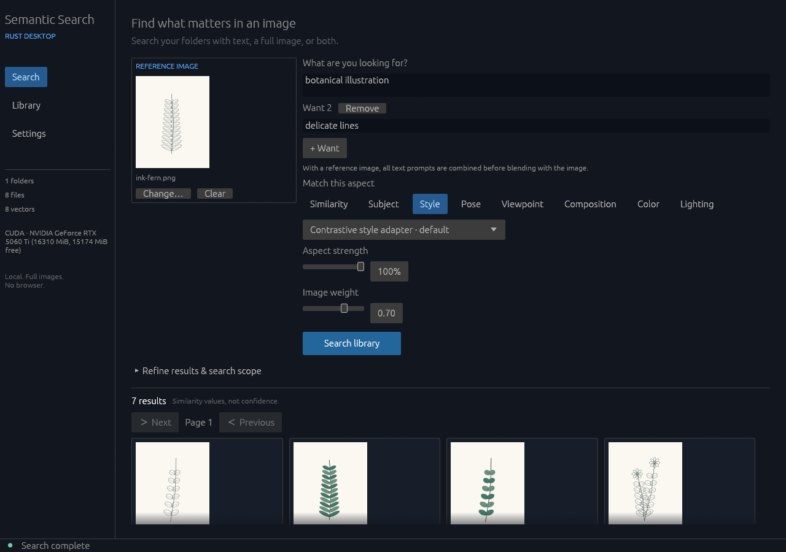
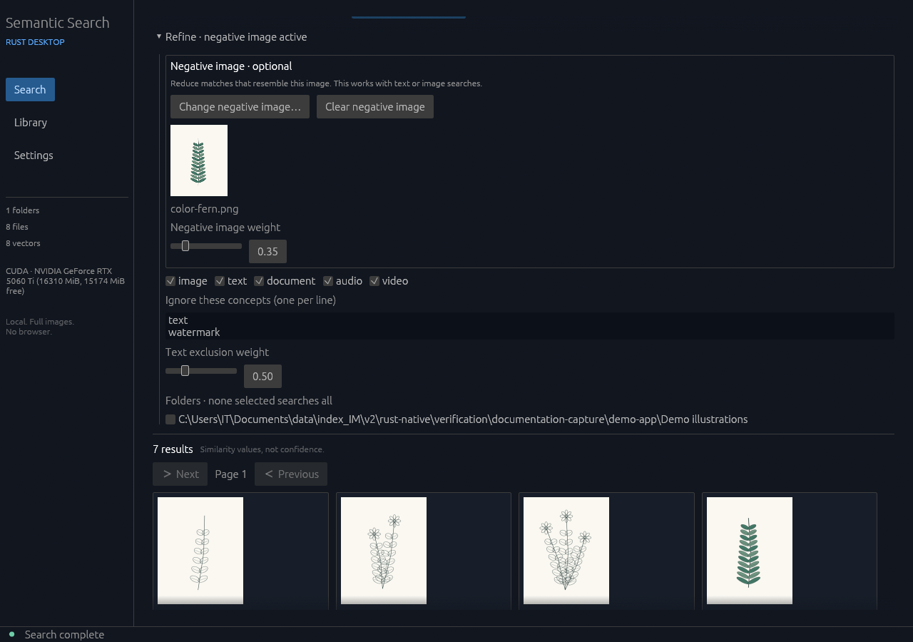
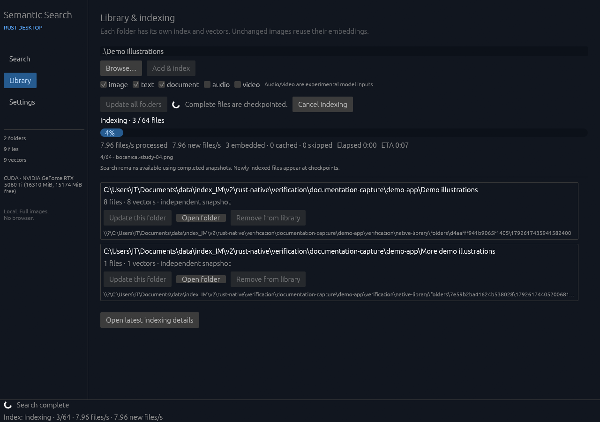
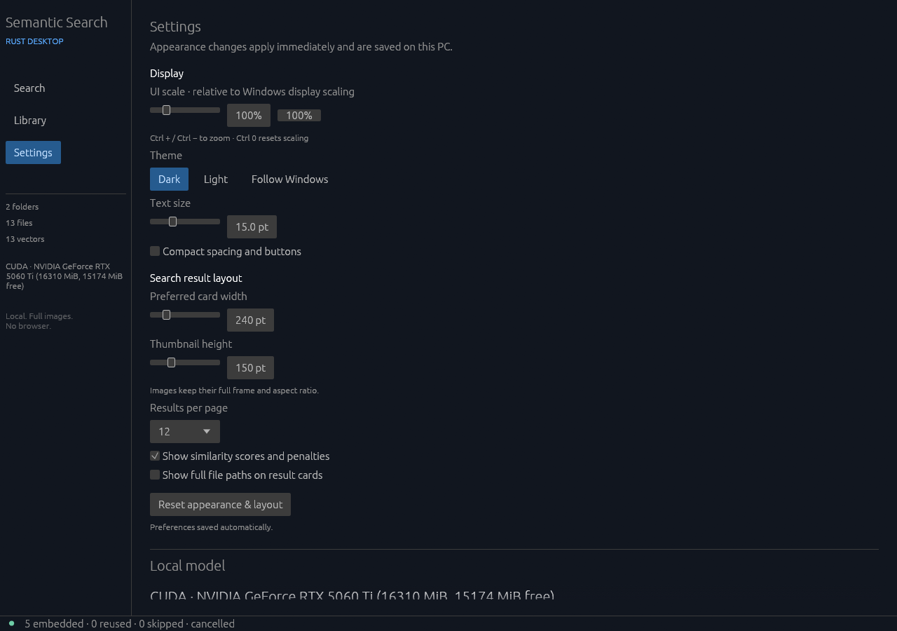
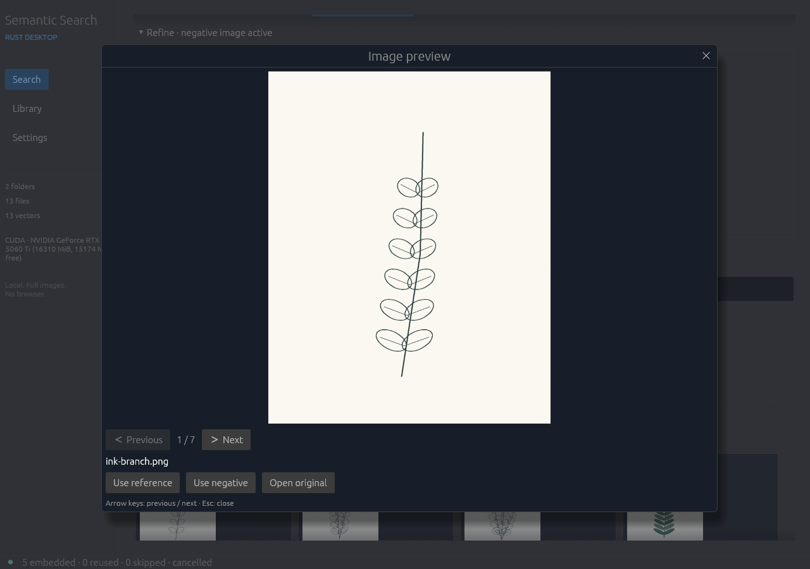

# Refseek

Search your own art and reference folders with a description, an example image, or both. Refseek returns pictures from the folders you add. Searches run on your computer.

## Download for Windows

Version **2.2.0** is available for both editions. Choose an app from the [latest release](https://github.com/Y1-studio/Refseek/releases/latest). Both downloads include the model. You don't need to install Python, Rust, or a separate model server.

| Download | Interface |
| --- | --- |
| [Refseek-Desktop.exe](https://github.com/Y1-studio/Refseek/releases/latest/download/Refseek-Desktop.exe) | Desktop window with display scaling, text size and layout settings. Built with Rust. |
| [Refseek-Browser.exe](https://github.com/Y1-studio/Refseek/releases/latest/download/Refseek-Browser.exe) | Search page in your usual browser. Built with Python; keep its launcher window open while using it. |

An `.exe` is a Windows application file. Download the app you want, put it in its own folder, and double-click it. The **Source code** downloads are for building the app yourself.

Leave several gigabytes of disk space for the included resources. Loading takes time, particularly on the first launch. Refseek tries compatible NVIDIA CUDA devices, then Vulkan graphics, then CPU. It uses the graphics drivers already on your computer.

## Start searching

1. Open **Library** in the desktop app, or **Library & indexing** in the browser app.
2. Add a folder of pictures and start indexing. This creates a searchable catalogue without moving your originals.
3. Open **Search**. Describe a picture, choose a reference image, or use both.
4. Click **Search library** on desktop or **Search** in the browser, then click a result to open its preview.

With a reference image, choose what to match: **Similarity**, **Subject**, **Style**, **Pose**, **Viewpoint**, **Composition**, **Color**, or **Lighting**. For example, Style asks for pictures drawn or painted like the reference, including pictures of different subjects.

Style starts with the **Contrastive style adapter**. Style and pose matches are approximate; the subject and background still influence the results. Pose matching uses image embeddings, without a joint detector. The style adapters were fitted on 12,940 images from 84 artists, but the full-data exports and their transfer to the bundled Q8 model still need evaluation on new collections.

Use **+ Want** for more descriptions. Add a negative image to push similar results down, exclude concepts, or limit the folders searched. You can search saved work while indexing continues. In the preview, arrow keys move between pictures without resizing the window.

Both editions offer **Include / Skip** rules in an expandable folder tree, a shortcut to search only a picture's folder, and an **Index dimensions** setting. New libraries default to 768 dimensions. Existing libraries keep their saved dimension. The trained Style methods retain full vectors at smaller search dimensions.

## What changed in 2.2

**Faster folder updates:** saved paths, sizes and modification times let unchanged files skip reading, resizing and embedding. Refseek still scans directories to find new or removed files. Use **Verify file contents** when an edit may have preserved both the size and modification time.

**Remembered indexing choices:** both editions start with images selected and two CPU preparation workers. Change the file types or worker count and Refseek remembers them. Image preparation runs ahead of model inference through a bounded queue. Desktop includes an optimized resize path; Browser overlaps two embedding requests.

**Safer saved work:** completed files are checkpointed. Failed or cancelled replacements keep previous vectors, incomplete scans cannot publish removals, and snapshot verification protects publication and cleanup. An unchanged update leaves both saved catalogs intact.

Read the [2.2.0 release notes](docs/RELEASE_NOTES.md) for the complete changes, upgrade steps and verification limits. The bundled models and trained style weights are unchanged.

## Desktop screenshots

| Refine and negative images | Library and indexing |
| --- | --- |
|  |  |

| Display settings | Image preview |
| --- | --- |
|  |  |

Click an image for full size. These captures show the Rust app with [demo illustrations](docs/screenshots/README.md). The browser app has a different layout.

## Updates and saved libraries

Close the old app, put the new EXE in the same folder, and keep the existing data folder. Update shortcuts if the EXE's name has changed.

Put both EXEs beside the same `data` folder. The desktop app uses `data/library` for its index. Browser uses `data/browser` for its index and accounts, with `.env` at `data/.env`. The two catalogues are independent, even when they search the same pictures. Browser can move an older portable library into this layout without reindexing.

## Guides and source

| Edition | Using the app | Building it |
| --- | --- | --- |
| Desktop | [Artist's guide](docs/USER_GUIDE.md) | [Rust source](native/README.md) and [build instructions](docs/NATIVE_BUILDING.md) |
| Browser | [Browser guide](docs/PYTHON_GUIDE.md) | [Python source and build instructions](python/README.md) |

`native/` and `python/` contain the application code. `docs/` contains guides and screenshots. Model weights, runtime binaries and trained adapter files are recovered from a matching release when building; they aren't stored in Git. The downloads are Windows x64 apps. This release has no Linux AppImage.

See the [third-party notices](THIRD_PARTY_NOTICES.md) and [publishing instructions](docs/PUBLISHING.md). No project-wide source license has been selected. Third-party components retain their own terms.
