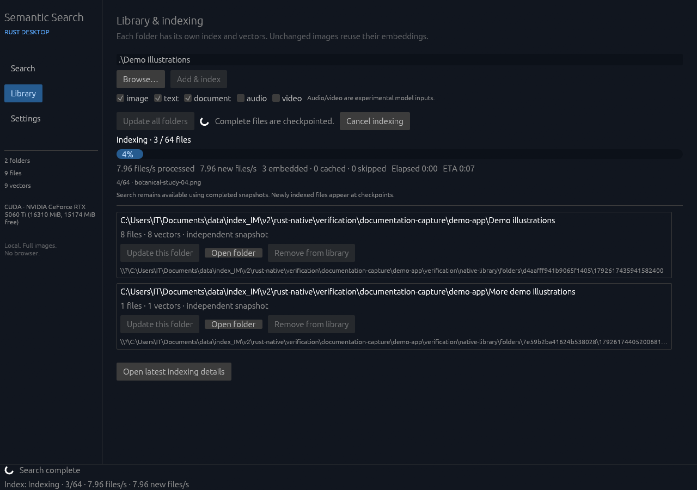
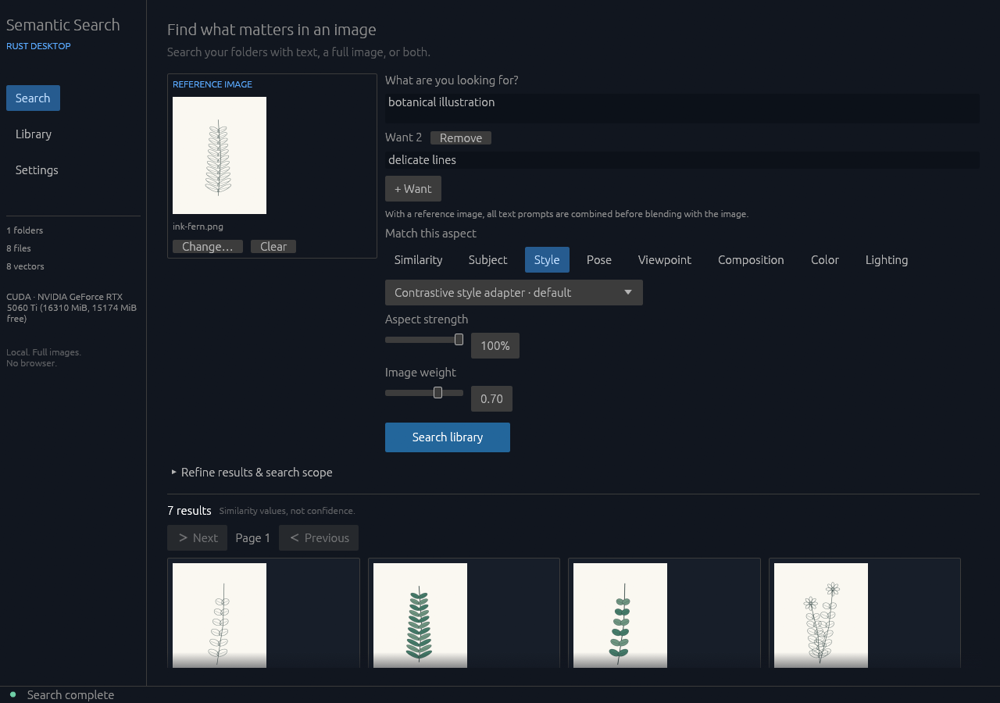
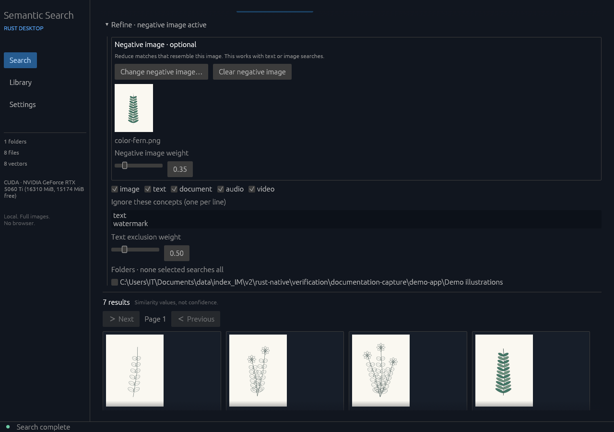
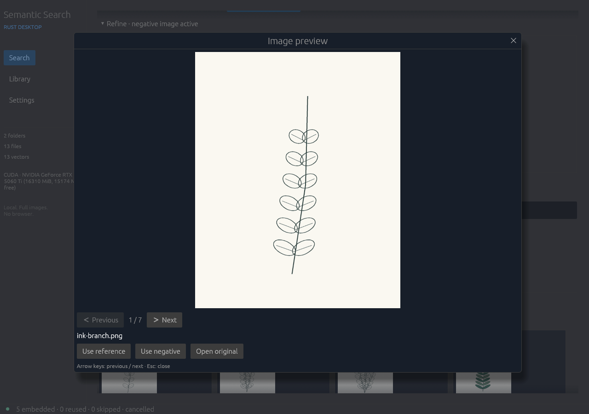
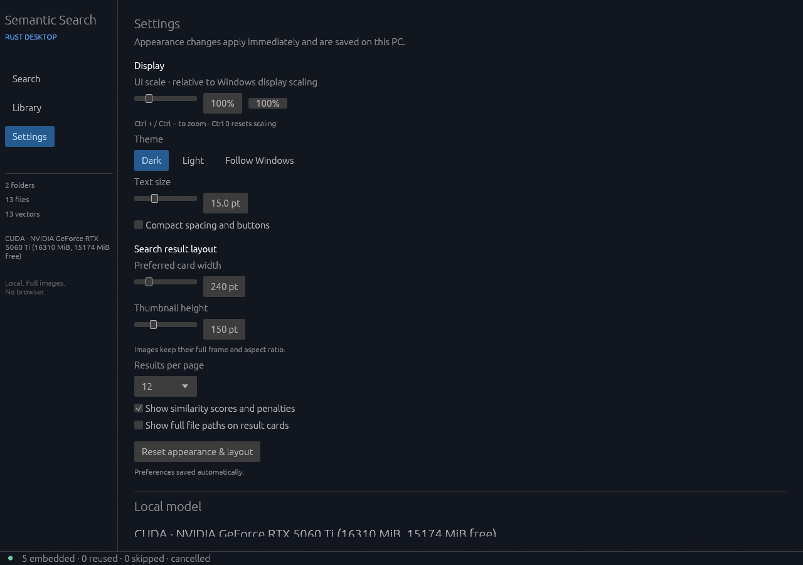

# Desktop guide for artists

Refseek finds pictures in the folders you add. Describe what you want, or give it an example image and choose which feature to match. Your original pictures stay in their folders.

For your first search, follow the next three sections. The rest of this guide explains the controls.

## Open the app

Download [Refseek-Desktop.exe](https://github.com/Y1-studio/Refseek/releases/latest/download/Refseek-Desktop.exe). An `.exe` is a Windows application: double-click it to open it. Windows sometimes hides the ending, so the file can appear as **Refseek-Desktop**.

Keep the app in its own folder, such as `Documents\Art Search`. To make one, open Documents, right-click an empty space, choose **New > Folder**, and give it a name. Move the downloaded application there. If you received it in a ZIP file, right-click the ZIP and choose **Extract All** first.

Leave several gigabytes free for its working files. On opening, a small startup window appears, followed by model-loading progress. Wait for loading to finish. The first launch takes longer because the app prepares its included resources.

The left menu has **Search**, **Library**, and **Settings**.

## Add a picture folder

1. Click **Library**, then **Browse…**.
2. Choose a folder of pictures. Refseek also looks inside its subfolders.
3. Leave **image** checked for pictures. Images are selected by default; any file-type changes are remembered.
4. Click **Add & index**.

Indexing creates the information Refseek needs to search each file. Start with a small folder you know well so you can judge the results before preparing a larger collection.

The progress display reports:

| Label | Meaning |
| --- | --- |
| files/s processed | Files checked per second, including reused files. |
| new files/s | Speed of preparing files that need new search information. |
| embedded | Files with newly created search information. |
| cached | Files whose saved search information was reused. |
| skipped | Files the app couldn't prepare. |
| Elapsed | Time spent on this job. |
| ETA | Estimated time left. The estimate changes as work continues. |

You can search while indexing runs. Results use completed work saved in batches; search again to include the latest additions. **Cancel indexing** stops after the current work can finish safely and keeps completed work.

## Search with words

Open **Search**. In **What are you looking for?**, type a description such as `a person sitting on the floor` or `a forest path in warm evening light`. Click **Search library**, then click a result to preview it.

Start with a short description. If the results are too broad, add a detail and search again. If an old reference image is selected, click **Clear** beneath it for a text-only search. That removes the search example from the controls; your image file stays on disk.

## Search with a reference image

A reference image is the example Refseek compares against your collection. It can come from any folder, including one you haven't indexed.

Click **Choose an image…**, or drag a picture from a Windows folder into the app. Select a matching feature, then click **Search library**.

| Feature | What it asks the search to match |
| --- | --- |
| Similarity | Overall resemblance, including subject, appearance and layout. |
| Subject | What the picture contains. A rabbit photo can be a reference for rabbits drawn in other media. |
| Style | How the picture is drawn, painted or rendered. An ink beetle can be a reference for similarly drawn plants. |
| Pose | Body position, such as sitting or raising the arms. |
| Viewpoint | Viewing angle, such as a side view or a view from above. |
| Composition | The arrangement of subjects and shapes in the frame. |
| Color | Colours and palette. |
| Lighting | Light and shadow. |

Refseek uses the whole image. Style and pose matches are approximate, and the subject or background can still affect the ranking. Pose matching doesn't detect body joints.

For Style, start with the default **Contrastive style adapter**. **Current style adapter** and **Existing aspect method** offer other rankings of the same collection. Compare them with the same reference.

**Aspect strength** sets how much the selected feature affects the ranking. Lower it to include more overall resemblance. Click **Search library** after adjusting it.

Use **Change…** for another reference or **Clear** to remove it.

## Combine a reference with words

Choose an image, then enter a description. For example, use a painting as a Style reference and type `a house beside a lake` to describe the subject you want.

**Image weight** balances the two inputs: near 0 gives the words more influence; near 1 gives the image more influence. Start in the middle, change one control at a time, and search again to compare.

Click **+ Want** to add another description box. For instance, enter `a forest path` in one box and `warm sunset light` in another. **Remove** deletes that extra description.

For text-only searches, **Match all** combines the descriptions, while **Match any** ranks a result by its best match to an individual description. Match all isn't a checklist: a result can fit one description better than another. With a reference image, the text descriptions are combined before being balanced against the image.

## Refine results

Open **Refine results & search scope** for the following controls. Search again after changing them.

### Negative image

A negative image is an example of what to move down the results. Click **Choose negative image…**, select a picture, and search again. **Negative image weight** sets how strongly it affects ranking.

The comparison uses the whole negative image. It doesn't remove a particular object from the reference, and it can push down pictures you wanted. Use **Clear negative image** to remove its effect. The collapsed Refine heading indicates when a negative image is active.

Negative images work with text searches and reference-image searches.

### Ignore these concepts

Enter unwanted concepts, one per line, such as `text` or `watermark`. **Text exclusion weight** sets how strongly they lower a result's rank. Clear the words to stop applying them. Exclusions adjust scores; they don't guarantee that every matching file disappears.

### File types and folders

Leave **image** checked for picture results. Under **Folders and subfolders**, use **Include** to search a folder and **Skip** to leave it out. With no Include selections, Refseek searches the whole library except skipped folders.

The folder list starts with the indexed roots. Click **+** beside a folder to see its subfolders, or **Collapse all** to return to the root list. A rule applies to its descendants even when the branch is closed. For example, include `References`, skip `References\Photos`, then include `References\Photos\Poses` to put that last folder back in the search. Click **Clear folder filters** to return to the whole library.

Open a result's image preview and choose **Search this folder only** to repeat your search in the picture's immediate folder. Subfolders are excluded. **Search all folders** beside the main search button clears the folder filters and runs your search across the library again.

These controls filter saved results. They don't remove files from the index or change what gets indexed. A label such as `H:\draw` is a folder's address on your computer; select its checkbox instead of typing the address.

## Browse pictures

Click a result for a large preview. **Previous / Next** or the arrow keys move through pictures: Left/Up goes back, Right/Down goes forward. **Esc** closes it. The preview keeps its size and position when pictures change.

Inside the preview, **Use reference** searches with that picture; **Use negative** adds it to Refine; **Open original** opens the file in its usual Windows application.

On a result card, **Use image** searches with that picture, and **Show file** reveals its Windows folder. The Next and Previous controls beside the page number switch result pages.

Similarity scores order the results. A score isn't the probability that a picture is correct, and exclusions can lower it. When starting a different search, clear any old reference, extra Want descriptions or exclusions you no longer want.

## Update or remove a folder

After adding, editing or deleting pictures, open **Library** and click **Update this folder** beside the folder. **Update all folders** checks every folder in the library. Unchanged files reuse their saved information.

**Open folder** opens the source folder in Windows. **Remove from library** removes it from the catalogue and leaves its original files on your drive.

Keep external drives connected when searching their pictures. If you move or rename a source folder, add and index the new location, then remove the old library entry.

You can keep a picture collection in its own folder beside the EXE. Refseek includes that collection's subfolders. Its private `data` folder and active index cache remain excluded.

## Change display settings

Open **Settings**. Changes save automatically.

| Control | Effect |
| --- | --- |
| UI scale | Resizes text, buttons and controls together. |
| Text size | Changes the size of the words. |
| Theme | Selects Dark, Light, or Follow Windows. |
| Compact spacing and buttons | Reduces space between controls. |
| Preferred card width | Sets the width of each result card. |
| Thumbnail height | Sets the height of the small picture previews. |
| Results per page | Sets how many results appear on each page. |
| Show similarity scores and penalties | Displays ranking scores and the effect of exclusions. |
| Show full file paths on result cards | Displays the folder address beneath each filename. |

Scroll down if larger controls extend below the window. **Reset appearance & layout** restores display defaults and keeps the library.

Keyboard shortcuts: **Ctrl + +** increases UI scale, **Ctrl + -** decreases it, **Ctrl + 0** restores normal scale, and **Ctrl + Enter** runs a search.

**Settings > Local model > Image preparation workers** defaults to **2**. Enter a whole number up to the available CPU threads or choose Auto, which uses up to four workers. Refseek remembers the choice and applies changes to the next indexing job. More workers can help with large images, but use more memory and do not guarantee faster model inference.

Under **Local model**, start with **Backend for the next launch: Auto**. It tries a compatible NVIDIA graphics card through CUDA, then a graphics device through Vulkan, then the main processor through CPU. A manual backend change takes effect after closing and reopening Refseek.

## Choose index dimensions

Under **Settings > Local model > Index dimensions**, choose 768, 512, 256, or 128 before indexing an empty library. New libraries default to **768**. Smaller vectors keep the leading values from the model output and normalize them again.

An existing library keeps the dimension detected in its saved index, including older 768-dimensional libraries. The selector is locked after files have been indexed to avoid mixing incompatible vectors. Use a new application/library folder to start with a different dimension; don't delete a working index to change this setting.

Settings shows estimated vector storage for 10,000 files, assuming one vector per file. The totals are 35.84 MB at 128, 40.96 MB at 256, 51.20 MB at 512, and 30.72 MB at 768. Smaller dimensions keep a separate full cache for trained Style. At 768, search and Style share one copy. These estimates exclude metadata and earlier snapshots; documents can have more than one vector per file.

Library estimates vector storage during indexing. After a folder is saved, **Saved index** shows its active snapshot size, including metadata and any style cache. **Indexed originals** shows the total size of the indexed source files recorded at the last scan. Refseek does not copy those originals into the index. Earlier snapshots and model files are separate from the displayed index size.

Text and exclusions use the selected index dimension. Smaller dimensions don't skip the model's image-processing work. The 128 option reduces image-search quality; 768 is the default for artwork.

### Remove old checkpoints

After a changed index is saved, Refseek keeps the active catalog and one recovery catalog. It removes older snapshots that neither catalog uses. An unchanged rescan keeps the existing recovery copy.

If you upgraded from an older build, open **Library > Clean up old snapshots** to clear leftovers without reindexing. Refseek verifies both catalogs before cleanup and leaves original pictures, model files and unrelated files alone. The result appears next to the cleanup button and stays visible after you reopen Refseek.

Cleanup stops before deleting files if either protected index has unreadable JSON, invalid vectors, or a failed checksum. If startup fails, keep the data folder intact. `data/startup-error.json` records the error and, for a library-loading failure, checks whether the previous catalog is usable. This check does not activate the recovery copy. You can also close Refseek and run `Refseek-Desktop.exe --check-library`; its result is saved to `library-check.json` beside the app.

[Google's model guide](https://huggingface.co/google/embeddinggemma-2#3-matryoshka-dimension-truncation) describes the supported dimensions and normalization.

## Check GPU indexing

The Library progress display identifies the embedding backend and device. **CUDA** uses an NVIDIA GPU; **Vulkan** uses a graphics device; **CPU** uses the main processor. Scanning folders, reading files and preparing images still use the CPU, including when embeddings run on a GPU.

Auto waits for GPU initialization before trying the next backend. A first launch can take longer while graphics kernels are prepared. If it falls back to CPU, the displayed backend says so. `data/backend-attempts.json` and `data/logs/` record detection and startup failures. Keep these files with an error report.

## Keep your library during updates

The `data` folder beside the application holds settings and working resources; `data/library` holds the desktop search catalogue. Keep it. To move or back up Refseek, copy the whole application folder, including `data`. Your source picture folders also need to remain available.

To update, close the app, replace the EXE in the same folder, keep `data`, and open the new EXE. If its name changed, update your shortcuts too.

Close normally with the X at the top right. Allow ongoing work time to finish closing.

## Troubleshooting

**No results:** add a folder in Library and let indexing save some work. Check that its drive is connected, **image** is selected in Refine, and unwanted folder restrictions are cleared. Try a shorter description.

**Unexpected results:** check for a previous reference, extra Want descriptions or active exclusions. Clear them and try Similarity before changing one control at a time.

**New pictures are missing:** use **Update this folder**, then search again. During indexing, newly prepared files appear after the next saved batch.

**A picture won't load:** supported image inputs include JPG/JPEG, PNG, WebP, GIF, BMP and TIFF. Export layered Photoshop or Clip Studio artwork to PNG or JPEG for indexing. Incomplete or damaged files can still fail. Select **Show latest indexing details** in Library, then expand **Warnings** to see why files were skipped.

**The library is already open:** use the existing app window, or close it before opening another instance with the same library.

**The app can't save:** move its application folder somewhere writable, such as Documents, and check for free disk space.

For an error report, include the exact message or a screenshot, what you clicked, and the image or folder involved.

[Back to the overview](../README.md) · [Build instructions](NATIVE_BUILDING.md)

## Faster updates and content verification

**Update this folder** compares files with their saved paths, sizes and modification times. Matching files skip reading, resizing and embedding, while the directory scan discovers new files and removals. A completely unchanged update does not save another snapshot.

Use **Verify file contents** for edits that may have kept the same file size and modification time. This reads and hashes files, so it is slower. A failed or cancelled changed file keeps its previous saved vectors until a complete replacement is ready. Read **Show latest indexing details** for warnings and skipped files.
